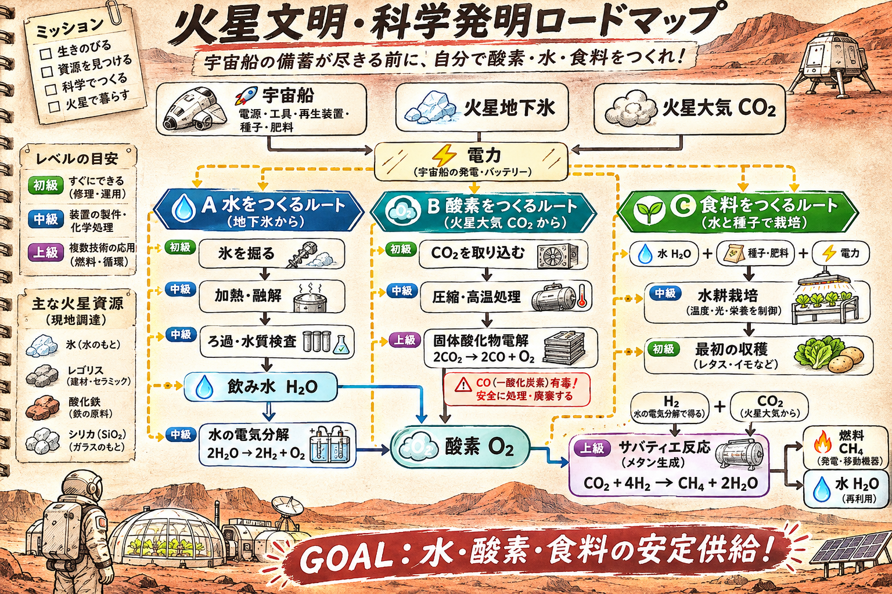

# Dr. Hematite

**火星を探査し、発明で生き抜く。**

[English](README.md) | 日本語



*発明ロードマップのコンセプト図。工程の条件と根拠は科学教材・資料で説明しています。*

Dr. Hematiteは、小学校高学年から高校生を対象にした、ブラウザで遊べる科学戦略ゲームです。NASAのHiRISEによる実測標高から作った火星の地形を探査し、相手陣営と資源や中継Podを争いながら、化学と工学の発明で基地を育てます。水・酸素・食料・電力はつながっており、新しい発明が基地の生産と生存を変えます。

NASA Space Apps Challenge 2026の課題 **Build a Junior Astronaut Mission Trainer** に向けて制作しました。

**オンラインで遊ぶ：** [日本語版](https://dr-hematite.vercel.app/game/?lang=ja) · [English](https://dr-hematite.vercel.app/game/?lang=en)

## 遊び方

1. 氷採取、採水、電気分解、栽培、太陽光発電、蓄電の設備が動く状態から始まります。
2. 地図を調査し、中継Podと資源地点を確保して原料を本拠地へ運びます。相手陣営も同じ補給経路を狙います。
3. 技術を研究し、装置を建てて、氷から水、水から酸素と水素、鉱物から金属、廃樹脂から部品を作ります。
4. 砂嵐、電力不足、設備故障に対応します。次に何を作るか決める前に、各装置の材料・生成物・停止理由を確認できます。

11×11マスの盤面、本拠地、研究ツリー、図解教材を通して、探査から生産、発明へのつながりを体験できます。ゲームUIは日本語と英語に対応し、科学教材は現在英語で公開しています。

## NASAデータ

- **実測地形：** 盤面には[Arcadia PlanitiaのクレーターのHiRISE数値地形モデル](https://www.uahirise.org/dtm/dtm.php?ID=ESP_025735_2185)の標高を使用しています。
- **地下氷の探索：** [NASAのSWIMマップ](https://www.jpl.nasa.gov/images/pia26045-swim-map-shows-subsurface-water-ice-on-mars/)を広域の地下氷候補として示し、ゲームでは個々の地点を調査します。

各マスの資源、採取量、設備費用、生産量はNASAの測定値ではなく、ゲームの規則です。データの範囲と画像の出典は[地図の出典と加工](game/assets/sources.md)に記録しています。

## NASA資料で学ぶ

図解教材では、発明に必要な原料、装置、生成物を説明しています。公開している各教材にNASA資料へのリンクがあり、次の題材などを扱います。

| 教材の題材 | NASAの資料 |
| --- | --- |
| 水の再生と電気分解 | [環境制御・生命維持システム（ECLSS）](https://www.nasa.gov/reference/environmental-control-and-life-support-systems-eclss/)と[STEMonstrations：質量保存](https://www.nasa.gov/stem-content/stemonstrations-conservation-of-mass/) |
| 火星大気の二酸化炭素から酸素をつくる | [MOXIEの火星実証](https://www.nasa.gov/solar-system/nasas-oxygen-generating-experiment-moxie-completes-mars-mission/) |
| 管理された環境で食料を育てる | [宇宙での植物栽培](https://www.nasa.gov/exploration-research-and-technology/growing-plants-in-space/) |
| 鉄を含む原料を探す | [火星中緯度の鉄元素分布図](https://science.nasa.gov/photojournal/map-of-martian-iron-at-mid-latitudes/) |
| 廃樹脂を再利用して交換部品をつくる | [3DプリントとReFabricatorの研究](https://www.nasa.gov/missions/station/solving-the-challenges-of-long-duration-space-flight-with-3d-printing/) |

## ローカルで起動

リポジトリのルートで実行します。

```bash
node scripts/serve_game.js
```

[日本語版](http://127.0.0.1:8765/game/?lang=ja)または[英語版](http://127.0.0.1:8765/game/?lang=en)を開いてください。ビルドは不要です。

## プロジェクトの資料

- [ゲームの案内](game/README.md)と[試作規則](game/RULES.md)
- [現在地](docs/CURRENT_STATE.md)、[Task 5](Task5.md)、[確認記録](game/tests/PLAYTEST.md)
- [NASA資源地図](docs/science/NASA_RESOURCE_MAPS.md)と[科学・発明ロードマップ](docs/science/SCIENCE_ROADMAP.md)
- [生命維持の収支設計](docs/design/LIFE_SUPPORT_BALANCE.md)と[判断の履歴](docs/DECISIONS.md)

開発協力者向けの共通文脈は[AGENTS.md](AGENTS.md)にあります。以前の構想は `_archive/` に保存しています。
