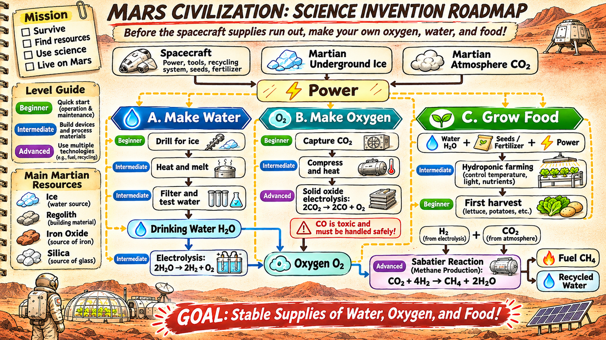

# Dr. Hematite

**Explore Mars. Invent what keeps you alive.**

English | [日本語](README.ja.md)



*Concept illustration of the invention roadmap. Process conditions and evidence are explained in the science lessons and documentation.*

Dr. Hematite is a browser-based science strategy game for upper elementary through high school students. Explore a Martian landscape built from NASA HiRISE elevation data, compete for resources and relay Pods, and grow a base through chemistry and engineering. Water, oxygen, food, and electricity are connected: every new invention changes what the base can produce and survive.

Created for the NASA Space Apps Challenge 2026 prompt **Build a Junior Astronaut Mission Trainer**.

**Play online:** [English](https://dr-hematite.vercel.app/game/?lang=en) · [日本語](https://dr-hematite.vercel.app/game/?lang=ja)

## How the game works

1. Start with working ice collection, water processing, electrolysis, farming, solar power, and battery storage.
2. Survey the map, secure relay Pods and resource sites, and bring raw materials back to headquarters. A competing faction can contest the same routes.
3. Research technologies and build equipment to turn ice into water, water into oxygen and hydrogen, minerals into metal, and recycled plastic into parts.
4. Respond to dust storms, power shortages, and equipment failures. Check each facility's inputs, outputs, and reasons for stopping before deciding what to build next.

The 11 × 11 battlefield, headquarters, research tree, and illustrated science lessons connect exploration to production and invention. The game interface is available in English and Japanese; the science lessons are currently in English.

## NASA data

- **Measured terrain:** The battlefield uses elevation from the [HiRISE digital terrain model of a crater in Arcadia Planitia](https://www.uahirise.org/dtm/dtm.php?ID=ESP_025735_2185).
- **Search for water ice:** The [NASA SWIM map](https://www.jpl.nasa.gov/images/pia26045-swim-map-shows-subsurface-water-ice-on-mars/) is shown as regional evidence of buried ice. Players survey individual sites in the game.

Local deposits, extraction yields, equipment costs, and production rates are game rules, not measurements from NASA. See the [map sources and processing record](game/assets/sources.md) for the data boundary and credits.

## Learn with NASA resources

The illustrated science lessons explain the inputs, equipment, and outputs behind an invention. Each published lesson links to its NASA sources, including:

| Lesson topic | NASA resource |
| --- | --- |
| Water recovery and electrolysis | [Environmental Control and Life Support Systems (ECLSS)](https://www.nasa.gov/reference/environmental-control-and-life-support-systems-eclss/) and [STEMonstrations: Conservation of Mass](https://www.nasa.gov/stem-content/stemonstrations-conservation-of-mass/) |
| Oxygen from Martian carbon dioxide | [MOXIE completes its Mars mission](https://www.nasa.gov/solar-system/nasas-oxygen-generating-experiment-moxie-completes-mars-mission/) |
| Growing food in a controlled habitat | [Growing Plants in Space](https://www.nasa.gov/exploration-research-and-technology/growing-plants-in-space/) |
| Finding iron-bearing material | [Map of Martian Iron at Mid-Latitudes](https://science.nasa.gov/photojournal/map-of-martian-iron-at-mid-latitudes/) |
| Recycling and making replacement parts | [3D printing and ReFabricator research](https://www.nasa.gov/missions/station/solving-the-challenges-of-long-duration-space-flight-with-3d-printing/) |

## Run locally

From the repository root, run:

```bash
node scripts/serve_game.js
```

Open [English](http://127.0.0.1:8765/game/?lang=en) or [Japanese](http://127.0.0.1:8765/game/?lang=ja). No build step is required.

## Explore the project

- [Game guide](game/README.md) and [prototype rules](game/RULES.md)
- [Current state](docs/CURRENT_STATE.md), [Task 5](Task5.md), and [playtest record](game/tests/PLAYTEST.md)
- [NASA resource maps](docs/science/NASA_RESOURCE_MAPS.md) and [science and invention roadmap](docs/science/SCIENCE_ROADMAP.md)
- [Life-support balance](docs/design/LIFE_SUPPORT_BALANCE.md) and [decision history](docs/DECISIONS.md)

The [AGENTS.md](AGENTS.md) file provides project context for contributors. Earlier concepts are preserved in `_archive/`.
