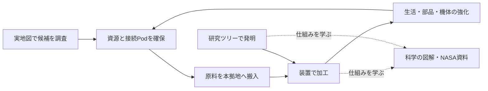

# Task4 — 本拠地で作り、地図で争い、図解で科学を学ぶ

作成：2026-11-14。更新：2026-11-15。**本書の中核となるゲームと英語教材を試作へ実装した。完了した機能と、未実施の評価を分けて記録する。**

**追加改修（2026-11-15）：** 初期生命維持と資源経済の指摘を反映。[収支の設計・確認](docs/design/LIFE_SUPPORT_BALANCE.md)を参照。初期設備と技術を両陣営へ用意し、生産・消費・停止原因・入手手順を表示。無人Podの消費を電力へ変更し、工業より生命維持を優先。現行テストは日英41件ずつ。下記23件は最初のTask4実装時の履歴。

| 範囲 | 2026-11-15の状態 | 残る確認・制作 |
|---|---|---|
| T4-01・05・07 | 新保存形式、本拠地の設備、採取点、Podの担当・接続・切断・奪取、生産順を実装。Pod選択時に確認済み資源への影響を予告 | Pod攻防の戦略比較、補給と未確認資源への影響表示 |
| T4-03・04・09 | 電解、MOXIE、栽培、蓄電、鉱物分析、鉄還元、金属加工、焼成建材、樹脂再生の9図と12題材の英語教材を公開。題材別NASA資料へリンク | 将来枝の教材、動画再生と字幕の確認 |
| T4-06・08 | 本拠地の設備と入出力、装置を選ぶ建設前予測、研究からの移動、砂嵐・故障、AI、勝敗を統合 | 強化前後の比較、画面操作だけの一戦、複数戦略の調整 |
| T4-02・10 | [20研究IDの教材監査](docs/science/TASK4_LESSON_AUDIT.md)とTask4テスト23件（日英）を追加 | 一次資料の全文・参考文献監査、実機・中高生の試遊 |

現在の操作と数値は [game/README](game/README.md)・[game/RULES](game/RULES.md)、検証範囲は [PLAYTEST](game/tests/PLAYTEST.md) を参照する。未チェック項目は、実装または評価が終わっていないものとして残す。

**最新の言語方針：ユーザーの「英語でもいい。提出は英語」に合わせ、提出用のゲーム・図解・教材・案内は英語版を先に完成させる。NASAの英語資料・動画をそのまま利用できる。既存のJP/EN切り替えは維持するが、新教材の日本語訳を英語版提出の必須条件にしない。**

目指す体験は、**地図で得た原料が本拠地の装置を通って使える資源になり、その発明が文明と戦力を育てることを、絵から理解して遊べる状態**。評価軸は「UIUXの分かりやすさ」「NASAを入口に科学を学べること」「対戦としての面白さ」の三つ。

実装順は本書を優先する。[Task3](Task3.md)・[Task2](Task2.md)・[Task](Task.md)の未完了項目は消さず、下記へ対応付ける。Astraで設計、Solで開発する方針を引き継ぐ。担当モデルにかかわらず、試作値をユーザーが確定した仕様と扱わない。

## 1. 今回の指摘と、直す対象

以下の「現状」はTask4実装前の棚卸し。現在動く状態は冒頭の進捗表と [現在地](docs/CURRENT_STATE.md) を参照する。

| 現状の問題 | 確認した実装・状態 | 次に変えること |
|---|---|---|
| 「仕組みを学ぶ」が工程の理解につながりにくい | `game/learn/lesson.js` は電解以外の多くを矢印文字列から自動生成し、同じ注意文と汎用部品アイコンを繰り返している | 題材ごとに、装置の断面・材料の変化・入力と出力を描く |
| 科学の説明とゲーム都合の説明が混ざる | 「一マスの氷量」「建設費・出力」「ゲームでは水1と電力2」などが教材本文に入る | ゲーム用の費用・収量・配置・戦闘規則は教材本文から外す |
| 画面を読んでも工程が見えない | 横画面では本文11px、補足10px程度。小さい絵、工程一覧、説明、注意欄が並ぶ | 中央に大きな図、短い説明、必要時だけ開く詳細。文字を縮小して一画面に詰めない |
| 出典リンクが学びの道筋になっていない | `lesson.html` は題材に関係なくSWIM・MOXIE・Markdown資料への共通リンクを出す | 題材別に、やさしい公式解説／動画／研究資料を選ぶ |
| 科学でない題材まで科学教材の形になる | 架空のビーム・セントリーにも「仕組みを学ぶ」がある。不明な教材IDは電解に置き換わる | 科学教材があるノードだけ学習リンクを出す。架空機体の性能はゲーム内の操作説明へ |
| 本拠地で「何がどう作られるか」が抜ける | 現行は地図のマスに加工施設を置き、陣営在庫へ生産する。[本拠地＋Pod案](docs/design/HQ_POD_GAMEPLAY.md)は未実装 | 装置建設と生産を本拠地画面へ移し、地図の原料搬入につなぐ |
| 現行の動作と次案が混在する | 放射線イベントは現行コードに残る。既存34件の自動テストは現行版の機能確認 | Task4の対戦は放射線を対象外にする。次案用にルール・AI・テスト・セーブを更新する |

資料へのリンクがあること、文章を表示できること、テストが通ることだけでは、中高生向け教材や遊びとして合格したことにはしない。

## 2. 維持するものと、次の試作で採る案

**ユーザーの指示として維持するもの**

- NASA等の実地図を使う。地図が主画面、研究は別ページ。研究の大きな広がりを残す。
- 火星素材から加工・発明し、文明を強化して相手を倒す。2チーム、戦闘、砂嵐。
- 加工設備は本拠地の別画面で作る。地図は探査・資源確保・Pod争奪・戦闘を中心にする。
- モバイルで縦横に対応。固定のHeader／Footer帯を設けず、地図・研究を上下左右に動かせる。
- JP/EN切り替えは維持し、提出用の英語表示を優先して仕上げる。詳細な原画は一枚のまま、独立URLで拡大して見られる。
- 放射線イベント・被害・敗北は今回は扱わない。

**次の試作の開始案**

各陣営に本拠地一つ、少数の中継Pod、陣営共通の在庫を持たせる。Podに住民・工場・個別倉庫・個別電力を増やさない。本拠地の設備は自動配置・自動配管とし、まず「何を作るか」に集中させる。配置パズル、手動輸送、オンライン対戦、新兵種大量追加は今回の範囲外。

Podの数・担当範囲・接続線、建設費、初期備蓄、供給量、敗北までの猶予は試作値。通常費用で一戦を通し、両開始位置で調整する。大きな研究ツリーを残すことと、全枝を今回ゲーム機能にすることは分ける。

## 3. プレイヤーに見せる三つの場所

| 場所 | ここで考えること | 主な表示・操作 |
|---|---|---|
| 地図 | どの資源・Podを確保し、どこを守るか | 実地形、機体、資源候補、担当境界、必要時だけ接続線。選択時の主操作は原則2〜3個 |
| 本拠地 | 何を作り、何を増強するか | 本拠地の成長する絵。選んだ系統の「原料→装置→生成物→用途」、建設・強化・停止理由 |
| 研究／学習 | 次に何を発明するか／なぜそれができるか | 円形ノードの研究ツリー。ゲーム上の効果と費用は研究詳細、科学は独立した図解教材 |

本拠地へは地図の自軍本拠地をタップして入る。不足の通知からも該当装置へ直接行ける。戻ると地図の選択・カメラ・ズームが復元される。新しい常設ナビ帯を追加しない。

## 4. 教材の新しい形

### 最初に見せるのは、工程が分かる一枚

例：**「氷から、呼吸する酸素をどう作る？」**

採取した氷 → 加熱・水処理 → 水タンク → 電解槽 → 酸素タンクと水素タンク、を大きく描く。電力は装置への別の矢印で入れる。酸素は居住区、水素は次の素材・燃料の枝へつなぐ。小さなアイコンを横に並べるだけで完成としない。

- 初期表示：材料・装置・生成物の絵と短い名前、結論一文。全体のつながりを先に見せる。
- 工程をタップ：地下断面、ヒーター、フィルター、電極・分離部などを拡大し、その工程に絞って説明する。
- 「もう少し詳しく」：反応式、必要条件、物質やエネルギーの考え方。高校生も深掘りできる内容にする。
- 「NASAの解説・研究資料」：写真、公式動画、資料ごとの短い案内、原文・論文へ進む。

横画面では一工程の図を大きく、縦画面では図の下に説明を置く。全体図の拡大・移動は許容し、読ませる文字を一律に縮めない。原画の全文を最初から小画面へ押し込まない。

### 教材本文から外すもの

ユーザーが挙げた「ゲーム中の一マスの氷量は観測結果ではありません」「装置の出力・建設費・配置は遊びのための値です」の定型欄は撤去する。「科学・工学とゲームの抽象化」という大見出し、DP、ターン収量、占領規則、架空兵器の性能も科学教材本文に入れない。必要なゲーム仕様はゲーム内の詳細・[規則](game/RULES.md)、地図加工と仮配置は[出典](game/assets/sources.md)に置く。

科学として必要な情報は短く具体的に伝える。例えば「衛星で地下氷の手がかりを探す」「水を温めるだけでは飲料水にできない」「水の電解では酸素と水素の両方が生まれる」。実写真と描いた概念図、ISSの実験と火星での実証、将来の研究は写真キャプションや出典詳細で区別する。毎ページの長い注意欄にしない。

### 学習の深さと確認する理解

| 深さ | 内容 | 学習後に説明してほしいこと |
|---|---|---|
| 絵で分かる | 入力・変化・出力、装置が必要な理由 | 氷を手に入れてから酸素ができるまでの順番 |
| 中学生向けの基本 | 融解と化学変化の違い、電力、水素と酸素、植物に必要なもの | 温めた水と、電気分解した水で何が違うか |
| 高校生向けの発展 | 反応式、原子数の保存、酸化還元、エネルギー、条件と効率 | 酸素だけでなく水素ができる理由、別工程への利用 |
| 研究を読む | 一次資料の図・条件・結果、論文の参考文献 | 何が確かめられ、何がこれからの研究か |

年齢による閲覧制限は設けない。動画やクイズを研究解放の必須条件にしない。任意の一問で理解を確かめられるようにし、暗記より「なぜ止まるか」「何へ応用できるか」を問う。

## 5. 本拠地・資源・Podの試作ルール

[本拠地＋Pod案](docs/design/HQ_POD_GAMEPLAY.md)を、次の実装の開始点として具体化する。

| 項目 | 次版のルール案 |
|---|---|
| 所有 | 各資源地点は本拠地または一つのPodの担当区域に属する。担当は重複させず、境界とアイコンで分かるようにする |
| 調査 | 観測ローバーで調査する。調査情報は陣営ごとに保持し、占領だけで相手の未共有情報をすべて取得しない |
| 採取 | 調査済み・採取技術・担当拠点の所有と接続が必要。本拠地で作った採取装備を割り当てる。地図では「採取を開始」で配備し、加工施設の建設一覧は出さない |
| 搬入 | 有効な採取点から原料がターン処理で自動搬入。鉱床を押さえただけで水・酸素・金属が直接増えることはない |
| 接続 | 少数の候補線からなるPod網。自軍拠点だけを通って本拠地に到達すれば接続。任意の地表マスへ敵を置いただけで切れるルールは初版に加えない |
| Podの役割 | 担当資源の中継と前線機体の補給。Pod数だけで開発力や電力が自動増加する現行処理は引き継がない |
| 孤立 | 所有権は残り、搬入・補給が停止。別の自軍経路があれば継続。選択時に切れた線と復旧候補を示す |
| 占領 | 旧所有者の搬入・周辺補給を止める。本拠地の備蓄や装置は奪わない。新所有者も接続・調査・技術・装備を満たすまで収入を得ない |
| 採取装備の扱い | 初版案は所有者変更時に旧割り当てを解除し、新所有者が自分の装備を配備する。奪回も同条件。無償の装備複製・自動返金はなく、占領前の予告に含める。負担が重ければ試遊後に変更 |
| 本拠地の設備 | 本拠地画面で建設し、材料と電力が揃えば自動運転。配管のドラッグ接続や毎ターンの投入操作は不要 |
| 敗北 | 本拠地の占領、または水・酸素・食料の必要量を一定期間満たせないこと。猶予中は理由と残り期間を表示。一度の不足で即終了させない |

初期の氷は登坂研究なしで到達・調査・採取できることを保証する。本拠地の初期圏も永久の安全領域にはせず、初手保証と中盤の攻防を分ける。追加の氷、鉄系原料、前進用Podを争う価値を作る。レゴリスは採取・搬送に適した地点、大気CO₂は装置へ取り込む流れとして扱い、すべてを希少な鉱床にはしない。

### 本拠地で最初に見せる生産

| 系統 | 絵で追える流れ | 対戦上の選択 |
|---|---|---|
| 水 | 搬入された氷→採水設備→水タンク | 飲用・電解・栽培に同じ水を使う |
| 酸素 | 水＋電力→電解設備→酸素と水素 | 水を使うルートと、大気CO₂から作るルートを選ぶ |
| 食料 | 水・種子・養分・光・栽培環境→温室→食料 | 電力と水を酸素生成と分け合う |
| 電力 | 太陽電池→稼働中の装置／蓄電→不足時の放電 | 砂嵐前の蓄電と、動かす装置の優先 |
| 金属 | 鉄系原料＋水素＋熱→還元炉→金属加工 | 装置の強化、機体の強化、増援への投資 |
| 部品 | 持参材・廃樹脂→再生材→印刷工房→部品 | 新設と修理で同じ材料を使う |

種子・養分・触媒・フィルター・電子部品など、科学上必要なものを図から消さない。一方、それらをすべて新しい常時在庫メーターにはしない。初期装備や保守の前提を装置詳細にまとめる。CO₂や熱は物質在庫と電力の表示を混同しない。材料が有限なのに部品が永久に増える説明・処理にしない。

建材の枝は残し、放射線対策以外の実際の用途とゲーム効果を定めてから生産対象にする。未実装の水回収、ガラス、メタン、PHBは研究の将来枝として見せられるが、現在使える設備とは区別する。

### パラメーターの表示

- 地図：直近の改修を維持し、水・酸素・食料の**現在の備蓄**、開発力、ターンを小さく表示。電力不足や搬入停止は発生時に理由付きで知らせる。
- 本拠地：発電／需要／蓄電を分け、選択した系統だけ原料・生成物の在庫と次ターンの増減予測を出す。「6/2・2」のような無名の数値列にしない。
- 装置：入力、出力、必要電力、稼働状態、止まる理由。建設・強化前に費用と生産見込みの変化を示す。
- ターン結果：既存の「前→今」と生産・装置使用・生活使用の内訳を、新しい搬入・本拠地生産にも接続する。過去の実績と未来の予測は混ぜない。
- 不足からの導線：「氷の搬入停止→担当Pod」「電力不足→電源系統」「食料不足→温室」のように原因へ直接移動する。全通知を毎ターンの強制モーダルにしない。

## 6. 実装タスクと順序

実装・確認できた項目にはチェックを付けた。未チェックは制作、実機、対象年齢の評価などが残る。

| ID | 優先・依存 | 作業 | 完了条件 |
|---|---|---|---|
| T4-01 | 最初 | 現行版と次版の状態・ルール・教材の対応表を作る | 移す施設、残す採取地点、無効にするイベント、既存セーブの扱いが明確 |
| T4-02 | 最初。01と独立可 | 教材の内容・出典を監査し、科学教材とゲーム説明を分ける | 全研究IDの教材有無・題材・根拠・不足が一覧になる |
| T4-03 | 02 | 氷→水→電解の図解見本を一つ完成させる | スマホ実寸で入力・装置・出力と分岐が読める |
| T4-04 | 02・03 | 英語優先で学習ページ・原画・言語導線・題材別リンクを実装する | 学習本文にゲーム数値がなく、各工程から根拠へ進める |
| T4-05 | 01 | 本拠地・Pod・採取点のデータと生産処理を分離する | 所有・接続・搬入・加工・消費・保存が一貫する |
| T4-06 | 03・05 | 成長する本拠地と装置の画面を作る | 建設から最初の水・酸素・食料、金属・部品まで絵で追える |
| T4-07 | 05・06 | Podの担当境界・接続・占領と地図操作をつなぐ | 奪取・孤立・奪回・迂回接続の効果が地図と生産に一致 |
| T4-08 | 04・06・07 | 研究・資源表示・導入・砂嵐・AI・勝敗を統合する | 新ルールで人とAIが同じ条件の一戦を遊べる |
| T4-09 | 02〜04。先行教材完成後 | 残る科学系統の図解を作り、研究の広がりを整える | 公開する「仕組みを学ぶ」に汎用の穴埋め教材が残らない |
| T4-10 | 04〜09 | 機能、科学、操作、学習、戦略をそれぞれ検証する | 下記の受け入れ条件と未実施事項を記録 |

### T4-01 — 移行とルールの確定作業

- [x] `game/game.js` の地図施設・基地・生産・AI・イベント・保存、`game/RULES.md`、教材への参照を棚卸しする。
- [x] 本書5章の試作ルールを設定値と状態遷移へ落とす。中立Podの確保、敵Podの制圧と猶予、本拠地占領、同一ターンの両者敗北の扱いを明文化する。
- [ ] 初期圏・Pod網・双方の基本氷・鉄への経路を一枚の盤面で確認する。初手から山で詰まる変更を戻さない。
- [x] 次版は保存形式を分け、現行セーブを保全する。地図上の既存工場を黙って削除・二重変換せず、旧版の継続手段か、明示的な新ルール対戦の開始導線を用意する。
- [x] 放射線を次版の抽選・敗北・導入から外す。自動化や建材の効果を放射線頼みにしない。旧版の記録や科学資料自体を削除する必要はない。

### T4-02 — 科学教材と出典の監査

- [ ] 20の研究IDについて「科学の問い」「学習目標」「図で見せる変化」「一次資料」「対象となる学習の深さ」「制作状況」を整理する。
- [ ] 氷・融解浄化・電解・MOXIE・栽培・電源蓄電・鉱物分析・還元・金属加工・樹脂再生・印刷を主要教材にする。建材、自動化、ガラス、循環、メタン、PHBは根拠と内容を個別に確認する。
- [x] `beam` の架空兵器説明を科学教材から外す。`hopper` は移動性能をゲーム説明へ、推進の科学を扱う場合は独立した題材にする。`climbing` も山マス解放の規則ではなく、地形・摩擦・機体の科学を扱う根拠がある場合だけ教材化する。
- [ ] 特に氷の採掘方法、水質処理、鉄還元、建材を、SWIM等の地図資料だけで根拠付けない。工程を支持する工学資料・研究へたどる。
- [ ] 既存論文とその参考文献を確認する。論文名・著者・年・DOI/URL・該当図/節・実験か設計研究か・読み取れる主張を記録する。参考文献に載っているだけで本文未確認のものは採用済みにしない。
- [ ] 下記のNASA教材を題材と学年に対応付ける。英語の公式資料はそのまま利用し、何を学べるかを短い平易な英語で案内する。日本語訳の完了を待たない。専門用語は英語版でも絵や短い言い換えで補う。
- [ ] 共通の免責欄を撤去する位置、出典とゲーム仕様へ移す文章、科学上必要な説明の書き換えを一覧にする。

### T4-03 — 一つの図解を完成させてから広げる

- [x] 氷・地面の断面、採取、加熱と水処理、水槽、電解槽、分離した二つのガスタンクを同じ画風で描く。科学的な接続を先に確認する。
- [x] 氷の融解は加熱と装置内の条件、水処理は不純物と用途、水の電解は電力・電極とガスの分離が見える構図にする。別の工程を一つの魔法の箱にしない。
- [ ] 元のロードマップの探検ノートらしい魅力を引き継ぎ、読み物の絵とゲーム内装置の外観を対応させる。装飾より物質の変化を主役にする。
- [ ] イラストへ長文や反応式を焼き込まず、名前・矢印ラベル・字幕は翻訳できる文字層にする。反応式と原子の対応は人が編集できる形で照合する。
- [ ] 動かす場合も、光る矢印だけではなく、水が入り、二つの出口へ分かれることを表す。停止・コマ送り・静止図・動きを減らす設定を用意する。
- [ ] 文字サイズは本文16px程度を開始案とし、360px幅と横画面で確認する。ボタンの当たりは44px程度を確保し、10〜11pxへ縮小して収めない。

**見本の合格条件：** 図だけを見て、入力の水・電力、出力の酸素・水素を指し示せる。説明を読めば融解と電解の違いが分かる。初見での理解は実際の観察まで未評価とする。

### T4-04 — 学習ページと出典への導線

- [x] `game/learn/lesson.*` の汎用文字列分割を、題材別の教材データと絵に置き換える。ゲームの研究費・レシピ数値と科学の説明データを分離する。
- [x] 技術ごとに教材URLを明示する。未制作は学習リンクを出さず、公開済みの別題材へ黙って飛ばさない。不明IDには見つからない旨と教材一覧・戻る導線を出す。
- [x] 図解→工程拡大→詳しい説明→NASA解説／研究資料を実装する。資料カードには「何が分かるか」「言語」「資料の種類」を短く付ける。
- [ ] 公式動画は実際の再生可否、内容、字幕、該当箇所を確認してから掲載する。今回確認した動画ページの存在だけで視聴確認済みとしない。自動再生はせず、視聴不能でも静止図で学べるようにする。
- [ ] 原画ページを維持し、該当工程へ移動できるようにする。提出に使う原画・新しい図解は英語を優先する。PHBを提出用に公開するなら英語の図解を用意し、日本語原画のタイトルだけを英語にして済ませない。
- [ ] 図の出典・加工・クレジットを記録する。NASA公式ページに第三者素材が含まれる場合も個別の条件を確認する。
- [ ] JP/EN、代替テキスト、キーボード操作、戻る、直接URL、ゲームの選択・ターン・スクロール保持を確認する。日本語UIから英語教材へ進む場合は「英語」と明記し、ゲームへ戻ると元の言語を保つ。学習中に対戦は進まない。

### T4-05 — 搬入と加工の処理

- [x] 状態を本拠地の設備、地図の採取点、Podの所有・接続に分ける。陣営共通在庫を使い、Podごとの隠れた在庫を増やさない。
- [x] ターン処理を、双方の行動→占領・接続状態の確定→環境→搬入→本拠地の加工→生命維持→不足・勝敗→記録・保存、のように一意に定める。占領の猶予との整合を01で確定し、両陣営へ同じ順序を適用する。
- [x] あるターンの採取点が両者へ収入を出さないこと、孤立した採取点から搬入されないことを保証する。備蓄は切断後も残す。
- [ ] 生産計算を表示から分離し、実行・建設前予測・強化前予測・AI判断に共通で使う。停止理由と入出力の内訳を返す。
- [x] 水を同ターンの電解・温室へ渡せるか、加工優先、電池の充放電、故障設備の扱いを明示する。再計算や再読込で二重消費しない。
- [x] 初期部品・発電・備蓄で最初の生産系統を作れるか確認する。部品を作るために未建設の部品工場が必須となる初期の詰みを避ける。

### T4-06 — 本拠地の画面と成長

- [x] 着陸船・居住区を中心に、実際に建てたタンク・温室・加工設備が増える本拠地の絵を作る。実物のない施設を先に飾らない。
- [x] 水・酸素・食料／電源／素材・製作の系統を切り替え、選択中だけ流れを強調する。設備を自動配置し、毎ターンの配管操作を要求しない。
- [ ] 「研究済み、未建設」「稼働中」「原料不足」「電力不足」「故障」を絵・短い語・必要な数値で区別する。
- [ ] 建設候補の最初の表示を必要なものへ絞る。建設・強化の前後で在庫・電力・予測がどう変わるか示し、実行不能なら不足材料や研究へ進める。
- [x] 電解設備をタップすると水・電力の入力と二つの生成物が分かり、「仕組みを学ぶ」から対応する図解へ進める。
- [x] 機体製作と修理を本拠地へ接続する。素材の増産と前線への投資が同じ開発力・部品・金属を競合して使うようにする。

### T4-07 — 地図とPodの操作

- [x] 担当区域の境界と色を示し、資源を選ぶと所属Pod・接続状態・搬入先・停止理由が分かるようにする。
- [ ] 接続線・補給範囲は選択時または切替時に表示する。物流の候補線を、実測道路や機体の移動経路として描かない。
- [ ] 占領前に失われる搬入、孤立するPod、補給への影響を予告する。奪回や別ルート確保で復旧することを同じ表示で示す。
- [x] 地図の加工施設建設ボタンを本拠地への導線へ変え、採取点には調査・採取配備・状態確認だけを残す。工作機の役割をPod確保・修理・防衛支援で整理する。
- [x] 実標高と小さな山マス、登坂研究、地図・研究の上下左右パンを維持する。境界線や施設がタップ対象を隠さないようにする。

### T4-08 — 一戦への統合

- [x] 「調査→採取→本拠地で水を作る→研究で酸素・食料へ枝が伸びる」を短い導入にする。初回砂嵐までに全教材を読ませない。
- [ ] 研究完了後の主ボタンを、対象に応じて「本拠地で建設」「地図で採取点へ」「機体を製作」に変える。全技術を旧「地図で設置先を探す」に送らない。
- [x] 砂嵐による発電低下、蓄電消費、装置の停止理由を同じ予測で説明する。後続の砂嵐・故障には予告と対処の猶予を残す。
- [x] AIを本拠地の建設・原料搬入・Podの接続と争奪へ更新する。旧地図工場の建設や無料生産で補完しない。
- [ ] 本拠地占領と生命維持不足の二つの勝敗経路、猶予、同時敗北、結果画面、再対戦を通す。正常進行だけでなく以前の「Finishで進まない」の再現条件も追跡する。
- [ ] JP/ENの動的メッセージをキーと引数で扱い、ゲーム数値の表示・イベント・ログ・保存・学習ページで言語が混ざらないようにする。

### T4-09 — 科学の広がりを増やす

- [x] 最初の図解品質を基準に、CO₂からの酸素、電源・蓄電、栽培、鉱物分析、鉄還元と加工、樹脂再生と印刷を制作する。
- [ ] 電解で得た水素が還元へ、再生した樹脂が修理部品へつながる合流を示す。一本道の必修教材だけにしない。
- [x] `ceramics` の覆土・焼成・建材を混同した説明を分ける。今回外した放射線のゲーム効果を教材の目的にしない。
- [ ] 循環、メタン、ガラス、PHBは資料確認が済んだ範囲で教材化する。研究段階の枝は残し、完成していない施設や動画を使えるようには見せない。
- [ ] 研究・本拠地・教材で素材名と装置の絵を共通化し、見た目を覚え直さずに行き来できるようにする。

### T4-10 — 検証と引き継ぎ

- [ ] 機能：採取条件、接続・孤立・代替経路、占領・奪回、収入の二重計上防止、加工順、電力、実績と予測、保存復元、二つの敗北条件をテストする。既存34件も新仕様に対応付ける。
- [ ] 操作：JP/EN、360×800・390×844とそれぞれの横画面で、図・文字・戻る・詳細・学習リンクの重なりを確認する。実機のタッチ・回転は別に記録する。
- [ ] 通しプレイ：在庫書換え・敵停止なし、画面操作で「調査→本拠地建設→Pod争奪→砂嵐→勝敗→再対戦」を通す。
- [ ] 戦略：早期の前進・Pod確保と、本拠地の生産強化を比較する。両開始位置、同じ条件で試し、Pod一個で必勝、基地に籠もるだけで十分、同じ建設順だけが正解になる問題を探す。
- [ ] 科学：図の入力・出力・矢印・反応式と説明を一次資料に照合する。地球／ISS／火星の場所や、実験／設計研究を取り違えていないことを確認する。
- [ ] 学習：中学生・高校生の初見試遊で「何から酸素ができるか」「なぜ装置が止まったか」「水素を別の発明にどう使うか」を自分の言葉で説明できるか観察する。英語教材では参加者の英語理解も記録し、言語の難しさと科学の理解を混同しない。プレイ前後の短い問いと迷った操作を記録する。
- [ ] 提出用の英語導線を確認する。ゲーム開始→本拠地→研究→図解→NASA資料→ゲームへ戻る→勝敗まで、日本語だけの案内で止まらない。日本語訳が未完成でも英語版は提出できるようにし、言語と公開範囲を明示する。
- [ ] 学習評価の最初の目安は、図を見て約30秒で入力・出力を指せること、短い説明後に融解と電解の違いを説明できること。これは検証目標で、達成済みではない。対象者を確保できなければ未実施と記す。
- [x] `game/README.md`、`game/RULES.md`、`docs/CURRENT_STATE.md`、`docs/DECISIONS.md`、`game/tests/PLAYTEST.md`、本書を更新し、旧仕様・実装・試遊結果の違いを残す。

## 7. 教材へ使う一次資料の入口

2026-11-14にページの内容・存在を確認した。**動画の実再生、字幕、図の転載条件、論文全文の全参考文献の追跡は今後の作業。** NASAの対象学年表記は選定の手がかりであり、こちらの教材の分かりやすさを保証するものではない。

| 題材・資料 | 確認した内容と使い方 | 制作時の確認 |
|---|---|---|
| [NASA/JPL：地下氷を探す新しい地図](https://www.jpl.nasa.gov/news/nasa-is-locating-ice-on-mars-with-this-new-map/) | SWIMの地図、観測の組合せ、氷が露出したクレーター、掘削の構想図。氷の探し方の入口にする | 地図で探すことと、装置で採取することを別の工程として描く |
| [NASA：STEMonstrations — Conservation of Mass](https://www.nasa.gov/stem-content/stemonstrations-conservation-of-mass/)／[NASA+の動画](https://plus.nasa.gov/video/stemonstrations-conservation-of-mass/) | ISSで再生水から電解で酸素を作る題材。Classroom ConnectionはGrades 6–8と明記 | 水の電解と原子数の保存へ。ゲーム内の水1・酸素2と反応式の量を結び付けない |
| [NASA：Physical and Chemical Changes](https://www.nasa.gov/stem-content/stemonstrations-physical-and-chemical-changes/) | 物理変化と化学変化の公式教材。Grades 5–8／9–12の対象表記 | 融解と電解の違いに対応する説明・動画箇所を確認 |
| [NASA：ECLSS](https://www.nasa.gov/reference/environmental-control-and-life-support-systems-eclss/) | ISSの水処理・酸素生成・水素利用のつながり | 装置の系統図や水処理の根拠へ。火星の地下氷処理そのものの実証として扱わない |
| [NASA：MOXIEの火星実証](https://www.nasa.gov/solar-system/nasas-oxygen-generating-experiment-moxie-completes-mars-mission/) | 火星大気から酸素を作った実験と実機の紹介 | 水電解と別ルートとして、入力CO₂、装置、生成物を説明する |
| [NASA：Growing Plants in Space](https://www.nasa.gov/exploration-research-and-technology/growing-plants-in-space/) | Veggieなどの装置・写真と栽培条件 | Veggieの培地・根への水や空気の供給を、火星の水耕設備と同一視しない |
| [NASA：Growing Beyond Earthの中高生向け活動](https://science.nasa.gov/learning-resources/science-activation/watch-how-students-help-nasa-grow-plants-in-space-growing-beyond-earth/) | Grades 6–12の生徒が植物実験へ参加する活動 | 光・水・栽培条件を変えて考える発展教材の入口にする |
| [NASA：宇宙での3Dプリントと再生](https://www.nasa.gov/missions/station/solving-the-challenges-of-long-duration-space-flight-with-3d-printing/) | ISSの部品製作、ReFabricator、再生材と品質の話 | 修理部品の写真と再生工程へ。用途に合う材質・品質も説明する |
| [Mars Seed, Storkほか（2026）, arXiv:2611.13064](https://arxiv.org/abs/2611.13064) | 既存資料にあるPHB生産の設計研究。題名・著者・要旨を確認 | 全文の工程図・前提・参考文献を追跡し、やさしい英語の図解→研究詳細へつなぐ。現在の扱いは査読前プレプリント |

既存の[出典台帳](docs/science/REFERENCES.md)にある栽培資料の旧URLは今回の取得で404だったため、確認できた現行URLへ更新する。鉄還元・ガラス・建材・蓄電・水採掘など、上記だけでは根拠が足りない工程はT4-02で追加調査する。NASA解説と論文のリンクを数だけ増やす作業にしない。

## 8. Task4を完了とする条件

1. 地図で確保した原料が本拠地へ届き、装置を通って生活・製作へ使われることが見える。
2. Podの喪失で止まるものと残る備蓄が分かり、奪回・別経路・生産の変更を選べる。
3. 学習ページではゲームの架空数値や定型注意文より先に、科学の仕組みを大きな図で理解できる。
4. 公開されている学習リンクは、その題材に合った完成教材と確認済みの出典へつながる。提出用の英語導線が完成している。JP/EN切り替えと戻り先を保ち、日本語未訳の教材は英語と明示する。
5. 初期資源への到達、地図と研究のパン、帯のない画面、資源備蓄の表示、ターン進行を後退させない。
6. 両陣営が同じルールで一戦を完走でき、複数戦略の比較と学習・操作の評価状況を記録する。実機・対象年齢の未評価が残る場合は、機能実装完了と評価完了を分けて報告する。

**最初の区切り：T4-01〜03でルールと一つの図解見本を整え、T4-04〜08で「氷→水→酸素・水素→食料・金属」の一本を対戦へ通す。その後T4-09で教材を広げ、T4-10の試遊結果から調整する。**

