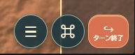

# Task5 — 生産が見える地図と、迷わない研究ボタン

作成：2026-11-15。**本書は次回の実装計画。初期生命維持・収支の改修済み部分を引き継ぎ、下部操作欄の生産表示と研究ボタンを改善する。** チェック欄は、これから行う実装・検証について記載する。

- [改修版を開く（日本語）](http://127.0.0.1:8765/game/?lang=ja)
- [収支の設計記録](docs/design/LIFE_SUPPORT_BALANCE.md)
- [現在地](docs/CURRENT_STATE.md)／[ゲームの起動方法](game/README.md)／[現行規則](game/RULES.md)
- [これまでの検証](game/tests/PLAYTEST.md)／[Task4](Task4.md)／[UIUXの指示・履歴](Task2.md)

ゲームのリンクは、このPCで `node scripts/serve_game.js` が起動していると開けるローカルURL。公開提出URLではない。

## 1. 今回のユーザー指示

1. 添付画像の下部操作欄付近に、何を生産できているか分かる表示を入れる。
2. 意味が分かりにくい研究のマークを改善する。
3. 改修版と収支設計へのリンクを含め、これまでの資源・生産・バランスの話をTask5へまとめる。



画像は「メニュー／⌘／ターン終了」が並ぶ箇所。現行の `game/index.html` では研究への入口に「⌘」と「発明」を使い、`game/task3.css` のモバイル設定がボタンの文字を `font-size:0` で隠している。アイコンだけの変更ではなく、名前も読める状態へ直す。

**維持する方針**：地図を主画面、研究を別ページ、本拠地で加工・設備建設。資源とPodを敵と争う。大きな研究ツリーと科学教材、JP/ENを維持する。固定のHeader／Footer帯は復活させない。ゲーム本体の縦横の最終採用は未決定。

## 2. 改修済みの土台と、今回まだ行っていないこと

| 範囲 | 現状 | Task5で行うこと |
|---|---|---|
| 初期生命維持 | 氷採取・採水・電解・温室・電源・蓄電を両陣営へ設置済み | その生産が地図上でも分かるようにする |
| 生産と収支 | 資源詳細に生産・加工使用・生活消費・次ターンの残量、停止理由を表示済み | メニューや詳細を開く前にも、生産の要点を示す |
| 資源入手 | 資源一覧と、確保・調査・装備・搬入の手順を実装済み | 生産不足から担当資源・Pod・本拠地へ迷わず進めるか点検する |
| 増設 | 建設前に次ターンの収支変化を比較できる | 建設後に下部の生産表示も変わり、効果を確認できるようにする |
| 研究の入口 | モバイルでは主に「⌘」だけが見える | 研究を表す絵と、常に読める「研究／Research」に変更する |
| 検証 | 既存記録では日英各41件通過、初回砂嵐・水・部品・金属生産を確認 | 新しい操作と表示を追加検証し、既存結果と区別して記録する |

41件は改修済みの機能検証であり、新しい生産表示の完成や、対戦バランス・初見理解の合格を意味しない。

## 3. 下部操作欄の設計案

以下は実装の開始案。ユーザーが確定した配置・アイコン・表示件数とは扱わず、同じ戦況の縦横画面で調整する。

### 生産の要点を、ボタンを押す前に見せる

既存の浮動ボタン群のすぐ上、または隣に、小さな生産サマリーを置く。操作群には「生産／Production」の入口を追加する。**ボタンだけを追加して終わらず、何が作られるかも地図上に表示する。**

初期状態の表示例（実装時は共通の資源イラストを添える）：

```text
次の生産  水 3 ｜ 酸素 2 ｜ 食料 2 ｜ ほか2種
メニュー     生産     研究     ターン終了
```

- 「次の生産」は、現在の装置・原料・電力・接続・予告済みイベントから計算する次ターンの生産見込み。詳細では「相手の行動前の予測」と示す。
- 水3は**生産量**。在庫の増加量ではない。初期の水は生産3−電解1−栽培1−生活1で、残量の差は0になる。
- 生産サマリーには原則として生活資源3種を示し、氷・水素・金属・部品・建材などは「ほかN種」から全件を確認する。初期例のほか2種は氷と水素。件数・優先順は仮案であり、金属などの初生産が見落とされないか検証する。
- 生産できなくなった生活資源は消さず、「水0・氷不足」「食料0・電力不足」などの停止状態を示す。色だけで区別しない。
- 「生産」またはサマリーのタップで、全生産物・稼働装置・入力と出力・消費後の差・停止理由を開く。現行の資源詳細を再利用し、別の計算や重複した在庫画面を増やさない。
- ターン終了後の実績は既存のターン結果で示す。次の予測と前ターンの実績を同じ数字として扱わない。
- 研究解放だけで作れると表示しない。未設置・原料不足・電力不足・切断・故障を区別する。現在のゲームにない製作待ち時間や進捗バーを作らない。

### 研究を、絵と名前で識別できるようにする

- 「⌘」を撤去し、研究ツリーにつながることを表す、枝分かれしたノードのSVGを第一候補にする。
- 日本語は「研究」、英語は「Research」を常時表示する。文字を消したり、ホバー時の説明だけに頼ったりしない。
- アイコンは独自の既存SVG体系に合わせる。資源・生産・メニュー・ターン終了とシルエットを区別する。
- ボタン全体をタップ領域とし、目安44 CSS px以上を確保する。英語ラベルが長い場合も省略や極端な縮小で対応しない。
- 既存の研究ページ・選択ノード・カメラ位置を維持して移動する。研究ページから地図へ戻る操作も名前で分かるようにする。

### 地図の操作面積を守る

浮動する操作群としてまとめ、画面の全幅を埋める帯は作らない。狭い縦画面では生産サマリーと操作群を二段にする案、横画面では並べる案を比較する。表示が増えた分だけ、既存のマス操作カードの位置・高さも調整する。地図の選択マス、移動先、攻撃確認、ターン終了を隠さない。研究・本拠地ページで下部ボタンを隠す既存の挙動は引き継ぐ。

## 4. 生産と資源バランスの引き継ぎ

具体的な設定値と理由は [収支の設計記録](docs/design/LIFE_SUPPORT_BALANCE.md) を正本とし、本書では次の検証に必要な要点だけを扱う。

| 操作・状態 | 現行の通常時の効果 | 新表示で読み取れること |
|---|---|---|
| 初期設備 | 水の在庫差0、酸素・食料は各+1 | 水は生産しているが加工と生活で使い切っている |
| 採水設備を1基増設 | 水の在庫差が0→+3。追加で氷1・電力2を使用 | 生産増加と、それに必要な原料・電力 |
| 温室だけ1基増設 | 食料の在庫差+3、水は−1 | 食料を増やすと水の備蓄が減る |
| 太陽電池を1基増設 | 発電12→15。初期装置の生産量は通常時には変わらない | 発電と物資生産が別であること、装置の稼働余力 |
| 鉱物地点と還元設備を確保 | 原料と水素を金属へ加工 | 地図の争奪が素材・機体の強化につながる |
| 廃樹脂を加工・印刷 | 部品を生産できるが、初期材料は有限 | 生産中でも原料切れで止まり得ること |
| 接続Podを増やす | 担当資源を搬入し、Podごとに電力1を使用 | 取得の利点と維持に必要な電力 |

基本の生命維持を初期装備で成立させ、拡張する原料・金属・部品と前線の接続を争う。採取だけで完成品を得る処理や、発電だけで食料が増える処理にはしない。観測・科学の根拠とゲームの仮値は、従来どおり区別する。

未評価のバランスは次へ引き継ぐ：早期攻勢と生産拡張の比較、両開始位置、資源担当が同距離の場合の公平性、Pod切断・奪回の損得、長期の部品・廃樹脂不足。数字を変更するときは、現行値との比較・理由・影響範囲を記録する。

## 5. 実装タスク・依存関係・完了条件

| ID | 順序・依存 | 作業 | 完了条件 |
|---|---|---|---|
| T5-01 | 最初 | 生産サマリー用の表示データを既存の予測から取り出す | 生産量・在庫差・停止理由が現行の予測・実処理と一致し、表示だけで状態を変えない |
| T5-02 | 01 | 下部へ生産サマリーと「生産」の入口を追加 | 地図にいたまま生産物が読め、1タップで全件と内訳を開ける |
| T5-03 | 02と配置を合わせる | 研究アイコンと常時ラベルを変更 | 日英・縦横で「研究／Research」が読め、研究ツリーへ迷わず進める |
| T5-04 | 02・03 | 不足・停止から原因と対処へつなぐ | 原料・電力・故障・Pod切断・未設置から、該当地点か装置へ進み、地図へ戻れる |
| T5-05 | 01の収支を利用 | 資源争奪・増設・初回砂嵐・長期収支を比較 | 通常費用での結果を記録し、未評価の戦略や偏りを明示する |
| T5-06 | 02〜05 | 操作・表示・保存・日英を確認し、引き継ぎ資料を更新 | 下記の受け入れ条件を確認し、実装・ブラウザ検証・人による評価を分けて記録する |

### 実装上の参照先

- `game/index.html`：`.bottom-nav`、研究ボタン、追加する生産入口。
- `game/game.js`：`forecast`、`production`、`inventoryHtml`、`productionLinesHtml`、`render`、ページ遷移とボタン処理。
- 予測の `balance[k].produced` が生産量、`netAll[k]` が残量の差、`flows` が装置の入出力と停止原因。共通データから描画し、資源チップごとに独立した生産計算を増やさない。
- `game/icons.js`、`game/i18n.js`：共通SVGと日本語・英語の操作名。
- `game/task3.css`、`game/task4.css`：モバイルの文字非表示、浮動ボタンの幅・高さ、横画面とデスクトップの上書き規則を合わせて見直す。
- `game/tests/task4-smoke.js`、`game/tests/PLAYTEST.md`：既存の確認を保ち、新しい表示・導線の検証結果を追加する。

新UIだけのために対戦を初期化しない。現行v5の在庫・設備・ターン・研究・言語を保持し、旧保存キーも保全する。バランス変更で保存形式の変更が必要になる場合は、変更理由と移行方法を別に定める。

## 6. 受け入れチェック

- [ ] 初期の地図で「研究」と「生産」の入口が読め、現在の生産物が確認できる。
- [ ] 水の生産3と在庫差0を区別できる。電解の酸素と水素の両方、金属・部品の生産も全件表示に含まれる。
- [ ] 採水増設の生産増、温室増設の水消費、太陽電池だけでは物資が増えない場合を、表示と実際の次ターンで照合する。
- [ ] 砂嵐、原料切れ、故障、Pod切断で生産量と停止理由が変わり、対処後に復旧する。生産0も説明できる。
- [ ] 研究完了と装置稼働を混同しない。生産詳細から該当装置・資源へ進み、地図の位置を保って戻れる。
- [ ] 生産表示の更新・言語切替・ページ往復・再読込で、資源の消費や二重生産が起きない。
- [ ] 360×800、390×844、800×360、844×390、デスクトップで、ラベル・タップ領域・地図・操作カードの重なりを目視確認する。横幅超過がないことだけで合格にしない。
- [ ] JP/ENで同じ導線を通し、英語の長いラベルも読める。キーボード操作と読み上げ用の操作名を確認する。
- [ ] 通常コストでPod争奪と生産拡張を通し、複数戦略・両開始位置・部品が減った後の行動余地を比較する。
- [ ] 対象年齢の初見試遊で「研究を開く」「今何を作っているか説明する」「水を増やす方法へ進む」を観察する。未実施なら未実施と記録する。

今回のTask5作成時点では、上記の新UIは未実装。Astraで設計、Solで開発する方針を引き継ぎ、検証を通じて配置・数値を見直す。
