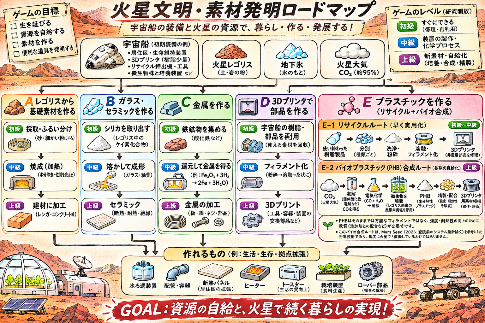

# Dr. Hematite — 科学をつなぎ、火星に文明をつくる

> 最新方針：地図を主画面、研究ロードマップを別ページにする。砂嵐は数あるイベントの一つ。具体的なゲーム性・パラメーターは [3案の比較](GAMEPLAY_THREE_OPTIONS.md) を優先して参照する。本資料は科学と発明の体験の核を整理したもので、ゲーム方式の採用決定ではない。

更新：2026-11-14。ユーザーからの「研究ロードマップの魅力が失われている」「もっとランダムに起こるミッションでよい」「複雑なものをシンプルに見せるべき」という指摘と、チュートリアルなどで少しずつ見せる提案を反映。

**大きな研究・発明ロードマップを育てながら、火星で次々に起こる出来事を科学で乗り越え、自分の文明を築くゲーム。**

[前回の画面案](../../assets/concepts/dr-hematite-roadmap-gameplay.png)は研究ノートを主画面にしたもの。ユーザーの最新指示により、地図を主画面にする方針へ変更した。

## 1. プレイヤーが見せたい・体験したいもの

中心にあるのは、材料、化学反応、装置、生活用品がつながった発明ロードマップ。「あの石から鉄が作れる」「酸素を作ったときの水素が、別の研究にもつながる」「いつかこの道具を自分で作れる」という発見と見通しが、遊びを進める理由になる。

NASA観測を手がかりに探査し、資源を得て、研究・製造を進める。発明によって基地が変わり、使える技術が増える。有限の備蓄やランダムな事件が、その大きなロードマップのどこを今進めるかという判断を生む。

**プレイヤーには「次に作りたいもの」があり、火星では「今対処したい出来事」が起こる。この二つの間で研究の順番を考える。**

## 2. 大きなロードマップをゲームの中心に置く

[SCIENCE_ROADMAP](../science/SCIENCE_ROADMAP.md)にある生命維持・素材・加工・製造のつながりを、企画全体として維持する。

| 広がる系統 | つながりの例 | 他系統との接点 |
|---|---|---|
| 水・酸素・水素 | 氷の採取、融解・浄化、水再生、電気分解 | 水は栽培へ、水素はメタンや鉄の研究へ |
| 鉄・金属加工 | 鉱物分析、酸化鉄の還元、加工、部品製造 | 反応装置・熱・還元剤と、工具・設備の製作 |
| レゴリス・ガラス・セラミック | 成分分析、原料処理、成形・加熱、材料評価 | 断熱・建材・器具。適切な組成と加工設備が必要 |
| 樹脂・3Dプリント | 廃材の選別、再生フィラメント、部品設計・印刷 | 修理や探査機材、将来のPHB研究 |
| 食料・居住・生活用品 | 栽培・水回収・遮蔽・居住区の拡張 | 水、電力、養分、素材を複数の系統から使う |

これらは科学的な概念関係で、材料を接続するだけで直ちに製造できる意味ではない。各工程の条件は科学資料で扱う。

参考となる、もともとのロードマップ画像：

画像は教育用の構想図。PHBなどの設計研究と実証済みの技術を区別し、正確な条件は文章資料を参照する。

## 3. ミッションは研究の優先順位を変える

最初のミッションは砂嵐への備えでよい。そこで「出来事を知る→対応する技術を探す→研究・製造→結果を見る」を体験する。砂嵐を越えた後も同じ基地と研究の進展が続く。

以後は、事件の内容・順番・組み合わせがプレイごとに変わる。故障・環境変化のほか、探索で得られる発見や研究の機会も含める。

| 発生する出来事の例 | ロードマップ上で考えられる方向 | 選択に影響するもの |
|---|---|---|
| 砂嵐の予報 | 蓄電、備蓄、電力配分の見直し | 既存設備、準備期間、今進めたい研究 |
| 水再生設備の不調 | 保守、別の採水手段、前処理の改善 | 交換部品、調査済み地点、利用できる装置 |
| ローバーの部品故障 | 手元の予備品、用途に合う印刷部品、金属加工 | 材質や精度、研究済み技術、探索の重要度 |
| 試料分析で新しい材料候補 | 鉄、ケイ酸塩、セラミックなどの研究 | 実際に同定された鉱物、処理条件、将来作りたいもの |
| 栽培設備で環境異常 | 環境制御、水処理、熱管理の改善 | 原因の診断、食料備蓄、材料と電力 |
| 放射線の警報 | 避難、遮蔽、船外作業の変更 | 避難場所、探査中の状況、既にある備え |

事件の表示は「何が起きたか・いつまでに困るか・何に影響するか」を短いカードにまとめる。対処に関係する研究の枝をハイライトできるが、一本道の正解として指定しない。応急処置で時間を稼ぎ、予定していた研究を続ける判断も認める。

ランダム性の発生条件・頻度は未決定。環境や設備の状態に関連する事件を選び、予測できない展開と、備えや技術が役立つ余地を両立させる。科学の反応則を乱数で変えたり、毎回同じ設備を壊して研究の成果を打ち消したりする設計にはしない。

## 4. 複雑な全体をシンプルに見せる

最初の画面では一本の短い道筋から始め、発見や製作を通して枝とつながりを少しずつ見せる。ロードマップの内容と奥行きは保ち、初回に読む情報と覚える操作を絞る。以下はそのための表示案。

| 見る範囲 | プレイヤーに見せるもの | 使う場面 |
|---|---|---|
| 広がりを見る | 発見した系統のつながりと、一歩先の発明。初期は短い道筋、遊ぶほど大きな図になる | 研究の成長を振り返り、「次はこれを作りたい」を選ぶ |
| 道筋を見る | 選んだ発明へ必要な工程と、別の作り方を強調する。他の枝は薄く残す | 何から調べ、どこへ投資するか考える |
| 一つを調べる | 役割、次に足りない条件、実行する操作。詳細を開くと反応式・材料・装置・出典 | 実際に研究・製造する |

新しい素材、研究、選んだ目標に応じて、関連する枝を見せる。将来の発明を少し先まで予告し、興味があれば遠い目標や全体構想も自分で開ける。研究済み、実行可能、前提不足はアイコンと短い文字で区別し、色だけに頼らない。表示を省略した枝にも科学的な前提は残り、画面を簡潔にするために必要工程を無かったことにはしない。

例：「金属の工具を作りたい」を選ぶと、鉱物の確認→還元→金属加工の道筋が光る。その途中で必要な水素が、水の電気分解の系統とつながっていることが見える。全体を閉じても、自分が目指す発明は残る。

操作の入口は「調べる」「研究する」「作る」。ゲーム全体の資源・設備・科学の関係を維持したまま、その場で必要な判断へ案内する。工程をカードでつなぐ操作は候補の一つで、巨大なロードマップを短いレシピだけに置き換えるものではない。

基地の成長と探索地図はロードマップから相互に行き来できる。技術を選ぶと役立つ設備が分かり、基地の問題を選ぶと関係する研究が分かる。具体的な画面配置は、この関係が見えるかを優先して検討する。

### 小出しに学ぶ導入案

最初の砂嵐への備えの中で、短い道筋をたどる操作を覚える。その後の新しい分野は、ランダムな出来事や本人の興味に応じて、その場で短く案内する。下の例をすべて初回ミッションに詰め込む必要はない。

| 理解の段階 | 見せる例 | 気づいてほしいこと |
|---|---|---|
| 一本の道をたどる | 氷の調査・採取→融解・浄化→使える水 | 見つけた資源を、工程と装置で使えるものに変える |
| 枝分かれを知る | 水の電気分解→酸素と水素 | 電力が必要なこと、一つの工程から複数の用途が生まれること |
| 別の系統とつながる | 既に得た水素が、鉄づくりの研究にも登場 | 過去の研究が別の発明にも役立つ。鉄鉱物、熱、反応装置なども必要 |
| 自分の方向へ広げる | 興味のある発明、基地の課題、ランダムな発見から次の枝を選ぶ | 同じロードマップでも研究の順序は変えられる |

一回の案内で覚える判断は一つを目安にする。理解済みの工程はまとめて表示でき、必要なら展開して見直せる。化学式や詳細条件は、素材や装置の役割をつかんだ後に開ける。

この順序は教え方の例で、全プレイヤーに同じ研究順を課す仕様ではない。何をきっかけに枝を見せるか、先をどこまで予告するか、案内を飛ばせる範囲は試作で検討する。

## 5. プレイのドラマ例

プレイヤーは「現地の材料で工具を作れる基地」を目指し、鉄の研究を始めている。

砂嵐を越えて研究を進めていたところ、水再生設備の不調が起きる。手元の部品で修理するか、氷の探索を先に進めて別の水源を作るかを選ぶ。氷を採取し、融解・浄化して使える水を増やせれば、電気分解と水素利用の研究にもつながる。

次にローバーが故障する。必要な部品が手持ちの樹脂で作れる用途なら印刷を検討できる。材質や精度の条件が厳しければ、予備品でしのぎ、金属加工に向けた研究を続ける。

危機の順番が変わると、先に伸びる枝も変わる。最初に設定した「工具を作りたい」という目標は残り、対処の過程で進めた別系統の研究が、その目標へ結びつく。

この例は固定のシナリオではない。複数の発明系統があるからこそ、偶然の出来事に自分の方法で対応できることを示す。

## 6. 地図と科学はロードマップを支える

NASAの観測から資源候補を考え、ゲーム内の探査・分析で実際に使える条件を確かめる。探査で得た材料は研究の枝へつながり、技術が進めば以前見つけた資源の価値も変わる。

広域の観測情報と局所の仮想資源を区別する。氷候補、鉄元素、ヘマタイト鉱物を混同しない。詳細は [NASA_RESOURCE_MAPS](../science/NASA_RESOURCE_MAPS.md)。

科学の複雑さを扱うために、素材・装置・エネルギー・副生成物の関係を保ち、表示を階層化する。実証・実験・設計研究・ゲーム上の仮定は [SCIENCE_RESEARCH](../science/SCIENCE_RESEARCH.md)に沿って区別する。

## 7. 今回の修正で確定した意図と、検討が必要な設計

ユーザーの明確な意図は、発明ロードマップの広がりを保つこと、最初の砂嵐の後はよりランダムにミッションが起こること、複雑な内容を分かりやすい表示で扱うこと。さらに、中高生が一度に理解する負担を減らすため、チュートリアルなどで小出しに見せる案が出た。

ロードマップの表示階層や目標からの経路強調は、その意図を実現するための設計案。資源量、ポイント経済、人手の表現、ターン制かどうか、最終目標、イベント頻度、実装範囲は引き続き検討する。先の案の「2人・10 sol・共通DPなし」を、ユーザーが承認した必須仕様として扱わない。

初回の導入で扱う操作や事件を絞ることと、ゲーム全体の科学・発明の幅を縮めることを区別する。試作でも複数系統のつながりと未来の発明を見せ、この企画の魅力が伝わることを優先する。

## 8. これから確かめること

- 全体を見た人が「いつかこれを作りたい」と思えるか。
- 目標を選んだ人が「次に何が必要か」を迷わず見つけられるか。
- 少しずつ枝が増えることで理解が進み、「自分の研究が広がった」と感じられるか。案内が長すぎたり、自由な研究を妨げたりしていないか。
- 同じロードマップでも、異なる事件の順番で研究の進め方が変わるか。
- 別系統で得た素材や発明が、以前からの目標にも役立つと気づけるか。
- 事件への対処と、自分の研究計画を両立できるか。

[教育UX](UX_EDUCATION.md)、[経済・イベントの比較案](GAME_DESIGN_OPTIONS.md)、[未決定の問い](IDEAS_AND_OPEN_QUESTIONS.md)も参照。

旧コンセプトは[修正前ZIP](../../_archive/2026-11-14-before-roadmap-correction.zip)に保存。基地と砂嵐対応を中心に描いた前回のPNGは旧案で、現在の画面方針を示すものではない。
