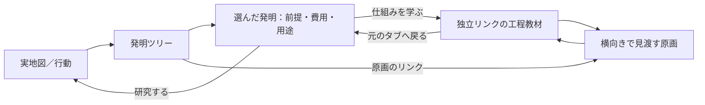

# 縦横比較と画面遷移（Task2 U02・U03）

更新：2026-11-14。下記はブラウザのCSS pxでの確認で、実機テストではない。地図は同じHiRISE切り出し、11×11の盤面、同じ初期在庫・部隊・施設で比較した。比較用の砂嵐予告・氷採取場・前線の敵も、両向きに同一状態を設定した。

## 行き来

教材は新しいタブで開き、ゲームの手番・イベントを進めない。戻ると地図のスクロール位置・ズーム・選択マス・研究ノード・対戦進行を保つ。再読み込みでも対戦は`localStorage`、画面位置は`sessionStorage`から戻す。教材の再生や閲覧は研究解放の条件にしない。

## 同じ戦況を並べた結果

| ブラウザ相当サイズ | 地図の表示領域 | 初期操作時の1マス | 戦況の読み方 |
|---|---:|---:|---|
| 縦390×844 | 390×844 px | 約67 px | 画面いっぱいの地図。上に資源とイベント、右下に小さな操作ボタンを重ねる |
| 縦360×780 | 360×780 px | 約62 px | 探査・採取地点を押しやすい。全前線を見るには「全体」やパンが必要 |
| 横844×390 | 左544×390 px、右300 pxは状況・操作 | 約67 px | 採取場と敵の横方向を同時に見て、操作札は地図を覆わない |
| 横780×360 | 左480×360 px、右300 pxは状況・操作 | 約62 px | 横の経路を比べやすいが、南北方向はパンが必要 |

初期探索では、縦は氷候補とローバーを大きく見られる。横は探索先の左右を比較しやすい。採取場を守りつつ別の経路から進む場面では、比較画像の両向きで採取場・敵・味方が見えるが、横は選択情報を右に置けるので地図の下部を隠さない。砂嵐予告は両向きで地図の近くに出し、横は右欄、縦は地図の上に置く。「生産見込み」から水・酸素・食料・電力への影響を調べる。

上下の固定帯を撤去しても、縦390×844と横844×390では、初期ズームの1マスがどちらも約67.4 pxとなる。同じ押しやすさで比較すると、横は右側に操作札があり地図を覆わない。縦は選択札を開くと地図下部に重なるため、見たい場所へパンできるようにする。ナビゲーションは画面全幅の帯ではなく、メニュー・発明・ターン終了の小さな浮動ボタンにした。敵や不足の見落とし、片手で届く範囲は人の操作で検証する必要がある。

「全体」で11×11マスを表示すると、縦390×844と横844×390はどちらも1マス約35.5 px。正確なタップ操作には小さいので、全体図は前線と経路の俯瞰に使い、機体操作時は再拡大する構成とした。横の全体図は地図領域の中央に配置する。

**試作上の採用：横画面を主な対戦レイアウトとし、縦画面でも同じルール・地図情報・操作を使えるようにする。** 右欄に在庫・予告・選択対象を並べると、前線を見る行為と判断を同時に行いやすいからである。これはブラウザ比較による実装判断で、ユーザーが最終決定した仕様ではない。端末の回転を強制しない。教材は別判断で、原画を横向きの独立ページで開く。

| 比較画像 | 縦 | 横 |
|---|---|---|
| 同じ前線・氷採取場・砂嵐予告 | [縦の盤面](../../game/assets/ux-scenario-portrait.png) | [横の盤面](../../game/assets/ux-scenario-landscape.png) |
| 初期探索 | [縦の盤面](../../game/assets/ux-portrait.png) | [横の盤面](../../game/assets/ux-landscape.png) |
| 同程度の対象サイズ | [縦・約67 px](../../game/assets/ux-equal-portrait.png) | [横・約67 px](../../game/assets/ux-equal-landscape.png) |
| 盤面全体 | [縦・約35.5 px](../../game/assets/ux-overview-portrait.png) | [横・約35.5 px](../../game/assets/ux-overview-landscape.png) |
| 研究ツリー | [縦のツリー](../../game/assets/ux-tree-portrait.png) | [横のツリー](../../game/assets/ux-tree-landscape.png) |
| 教材 | — | [電解の工程](../../game/assets/ux-lesson-landscape.png)・[原画の該当箇所](../../game/assets/ux-atlas-landscape.png)・[PHBの工程](../../game/assets/ux-atlas-phb-landscape.png) |

## まだ実機で確かめること

パン・ピンチとタップの誤判定、端末の安全領域、片手と両手での届きやすさ、日光下の視認性、初見の中高生が1分で目標と次の操作を見つけられるか。今の比較はブラウザ相当サイズでの表示と操作の検証である。横の小さい端末では操作札を縦スクロールする必要があり、施設候補の絞り込みをさらに検討する。
