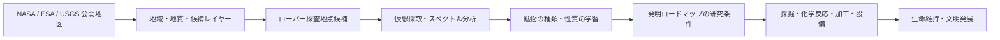

# NASA RESOURCE MAPS — 火星の資源が「どこにあるか」（最重要）

これは**単なるリンク集ではなく、ゲーム地図のデータ仕様に使う資料**。NASA/ESA/USGSの観測・推定の意味を保ち、ユーザーが実際の衛星科学を利用したことを説明できる構造にする。

## 1. どの地図が何を示すか

| # | 資源／地図 | NASA等の公式図・識別子 | 観測から言えること | 直ちには言えないこと |
|---|---|---|---|---|
| M1 | 地下水氷候補 | SWIM / **PIA26045**（2023） | 北半球中緯度で地下氷の存在が示唆／確認された分布 | 各地点で必ず所定量が掘れる |
| M2 | 浅い地下氷候補 | SWIM / **PIA26046**（2023） | 表層約1m以内の氷の可能性の分布と氷露出衝突地点 | 全マスに均質な氷床がある |
| M3 | Fe元素相対分布 | Mars Odyssey / **PIA04253**（2003） | 中緯度の鉄元素に関連する信号の空間差 | 高純度のヘマタイト鉱石や採算性のある鉄鉱山 |
| M4 | Si元素相対分布 | Mars Odyssey / **PIA04256**（2003） | 中緯度のケイ素元素に関連する信号の空間差 | 高純度シリカ・石英・ガラス原料の採掘可能量 |
| M5 | 灰色ヘマタイト鉱物 | **PIA05154**（2004、Meridiani Planum） | 特定鉱物（grey hematite）の地域分布 | 火星全域の鉄資源を網羅 |
| M6 | 広域ヘマタイト | TES / **PIA02056**（1999） | 赤道付近の粗粒結晶質ヘマタイトの検出 | どこでもヘマタイトが採掘できる |
| M7 | 含水鉱物・粘土・塩類 | ESA OMEGA + NASA CRISM（2022） | 複数地点の含水鉱物の検出位置と鉱物群 | そのまま利用可能な工業原料がある |
| M8 | 地質区分 | USGS **SIM3292**（2014） | 火星全球の地質単元・地形の空間分布 | 直接の採掘資源量 |

## 2. 公式NASAマップ：画像と元ページ

### M1：SWIM 水氷分布 — NASA/JPL PIA26045

- 公式説明：<https://www.jpl.nasa.gov/images/pia26045-swim-map-shows-subsurface-water-ice-on-mars/>
- NASA Photojournal直接JPEG：<https://photojournal.jpl.nasa.gov/jpeg/PIA26045.jpg>
- NASA Photojournal識別子：PIA26045。
- 2023-10-26公開。青い箇所は地下氷が検出／推定される地域。観測にはMars Odyssey、MRO、MGSなどを統合。
- **ゲームでの使い方**: 広域の候補地選定 → ローバー試掘 → 氷採取。濃淡は即「採掘量」ではない。

### M2：SWIM 埋没氷推定／露出衝突 — NASA/JPL PIA26046

- 公式：<https://www.jpl.nasa.gov/images/pia26046-distribution-of-buried-ice-on-mars/>
- 直接JPEG：<https://photojournal.jpl.nasa.gov/jpeg/PIA26046.jpg>
- 上部約1m以内の地下氷の可能性を示す。氷を露出させた衝突クレーターは補助的な観測根拠。

### M3：鉄元素（Fe）— NASA/JPL/University of Arizona PIA04253

- 公式：<https://science.nasa.gov/photojournal/map-of-martian-iron-at-mid-latitudes/>
- 元画像：<https://photojournal.jpl.nasa.gov/jpeg/PIA04253.jpg>
- 計測：Mars Odysseyのガンマ線分光。赤い領域に相対的に高い鉄元素信号。Utopia–Amazonis付近、Acidaliaで高濃度が報告。
- **ゲーム**: Fe-rich探索レイヤー。ローバーによる鉱物分析とヘマタイトの同定は別ステップ。

### M4：ケイ素元素（Si）— NASA/JPL/University of Arizona PIA04256

- 公式：<https://science.nasa.gov/photojournal/map-of-martian-silicon-at-mid-latitudes/>
- 元画像：<https://photojournal.jpl.nasa.gov/jpeg/PIA04256.jpg>
- 計測：Mars Odysseyのガンマ線分光。Tharsis北方（例：北緯約45度、西経約120度）に高い値。
- **ゲーム**: Si-rich探索レイヤー。ガラス向けのSiO₂含有鉱物かどうかは分析・処理が必要。

### M5：鉱物ヘマタイト — NASA/JPL/ASU PIA05154

- 公式：<https://science.nasa.gov/photojournal/targeting-a-hematite-rich-terrain/>
- 元画像：<https://photojournal.jpl.nasa.gov/jpeg/PIA05154.jpg>
- Meridiani Planum（Opportunity着陸地点付近）、TESによる灰色ヘマタイトの豊富な領域。
- **ゲーム**: 名前の由来を感じさせるチュートリアル／サンプル鉱物。氷候補地と同じ近距離マップに安易に重ねない。

### M6：ヘマタイト広域 TES PIA02056

- 公式：<https://science.nasa.gov/photojournal/hematite-map-tes/>
- 元画像：<https://photojournal.jpl.nasa.gov/jpeg/PIA02056.jpg>
- 火星赤道近く約0°N 0°Eの粗粒結晶質ヘマタイトの分布。

### M7：ESA / NASA 含水鉱物全球図

- 公式図：<https://www.esa.int/ESA_Multimedia/Images/2022/08/Global_map_of_hydrated_minerals_on_Mars>
- グローバル図：<https://www.esa.int/ESA_Multimedia/Images/2022/08/Mars_global_map_of_hydrated_minerals>
- 元データは**ESA Mars Express OMEGA と NASA MRO CRISM**。粘土鉱物、硫酸塩、炭酸塩などの場所・種類を示す。
- 例：Mawrth VallisとOxia Planumは粘土鉱物で知られる。
- **ライセンス**: ESA Standard Licence表記。転載／配布前に利用条件を確認。このパックにはESA画像を再配布していない。
- **ゲーム**: 鉱物研究、材料の原料分析、初期マップとは別の広域技術探索。

### M8：USGS全球地質図 SIM3292

- <https://pubs.usgs.gov/sim/3292/>
- 2014年、NASA向け作成、縮尺1:20,000,000、地質区分・地形情報。PDFとGISデータが公開されている（巨大なGIS ZIPは同梱していない）。
- **ゲーム**: 火星地形マップのベース／地質ラベル。単独で鉱物資源量は推定できない。

### その他の参照手段

- JMARS（ASU、地質・鉱物レイヤー）: <https://jmars.asu.edu/>、<https://jmars.asu.edu/download>
- SWIMプロジェクト: <https://swim.psi.edu/>
- NASA Planetary Data System: <https://pds.nasa.gov/>

## 3. 実在する場所と資源の対応

| 地域 | 観測の根拠 | ゲームへの転換 |
|---|---|---|
| Arcadia Planitia周辺 | 中緯度の水氷探査候補区域に関係 | 氷候補地のある架空の着陸地点を設定する余地 |
| Utopia Planitia | 氷研究・鉄元素が多いエリアに関する広域観測 | 探査候補として採用できるが、ローカル鉱床は架空化する |
| Acidalia Planitia | Fe元素の相対的に高いエリア | 元素・鉱物の違いを教える |
| Meridiani Planum | 灰色ヘマタイトの分光検出 | 「Dr. Hematite」発明ノートの基礎教材 |
| Tharsis北方 | Si元素が比較的多い地域 | ケイ素を含む鉱物の候補地 |
| Mawrth Vallis、Oxia Planum | 粘土鉱物マッピング | 粘土／鉱物の分析・セラミックへ |

**重要な地理的注記**: Meridiani Planumのヘマタイトと北半球の浅い氷は、一般に同じ数km圏内に確定配置できるわけではない。移動距離・実観測位置の縮尺を確認。世界地図で着陸地域を選び、その後は地域の「観測上あり得る候補」を探索する二段階方式を考えられる。

## 4. 探索→発見→科学→発明のデータフロー

**データ由来のラベルを付ける例**:

- `NASA OBSERVATION`: NASA衛星・ローバーから得た実観測・推定。
- `SIMULATED RESOURCE`: 地図を基にゲーム側が仮想設定した鉱量・成功率。
- `DISCOVERED IN GAME`: プレイヤーが試掘・分析によってゲーム内で確定した資源。

## 5. 最低限のデータ構造案（実装するなら）

| フィールド | 例 | 意味 |
|---|---|---|
| `layer` | `subsurface_ice`, `fe_element`, `hematite` | 異なる観測対象 |
| `source_id` | `PIA26045` | 元となる地図の識別子 |
| `source_url` | NASAの公開URL | 透明性／引用 |
| `region_name` | `Arcadia Planitia` | 地域名 |
| `observed_confidence` | `qualitative/high/unknown` | 元資料の確度と不確実性 |
| `simulated_yield` | ゲーム設定値 | 実測と混同しない採掘量 |
| `unlocked_by` | 探査／分析技術 | 学習ゲーム上の条件 |

### Codexのタスク候補

1. NASAの原本地図と元データの利用可能性を確認し、用途に適した縮尺・投影を選ぶ。
2. 公式画像に基づく学習画面と、ゲームの仮想マップを明示的に分離する。
3. 採掘可能量の実測がない箇所は、ゲームの仮定としてデータ表に記録する。
4. 資源を発明系統図のノードと紐づける。

## 参考元

[出典台帳](REFERENCES.md)の[R1]〜[R7]を参照。公式リンクは上にも併記してあり、CodexがオフラインでMarkdownを読んでも出典が分かる。画像取得用の[出典一覧](../../assets/nasa_maps/source_manifest.json)と[取得案内](../../assets/nasa_maps/README.md)も参照。
