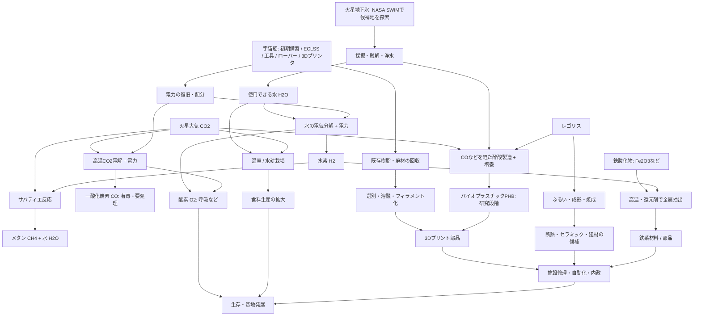

# SCIENCE ROADMAP — 科学・素材・発明系統図（最重要）

> 素材が別の素材を生み、発明が別の発明を可能にする。科学的知識とゲームの成長が同じ図に現れる。オリジナル発明ノートとして表現する（[参照画像](../../assets/roadmaps/)）。

## 全体図（Mermaid：テキストでも読める）

※ 分岐は教育用の概念関係。実装機材、触媒、栄養剤、分離工程、熱、保管、安全対策などは工程別に必要。単に元素を合わせると生成物ができるという意味ではない。

## 1. 初期段階：宇宙船は文明のスタートキット

| 持ち込み品の例 | 初期用途 | 次の技術への橋 |
|---|---|---|
| 気密居住区／ECLSS（水回収、空気管理） | 生存を保つ | フィルター修理、酸素生成、水再生 |
| 電源、太陽電池、バッテリー | 装置を動かす | 電力配分、自動化、蓄電 |
| 採掘ドリル／ヒーター／分析器 | 氷採取、鉱物評価 | 現地水・素材の製造 |
| ローバー／センサー | 地図と実地探査 | 採掘地点の発見 |
| 3Dプリンタ、工具、予備樹脂 | 小さな交換部品の製造 | 樹脂リサイクル、印刷材料の内製 |
| 種子、栄養塩、栽培設備 | 食料生産の実験 | 水耕栽培と食料自給率 |

特定の実在宇宙船の搭載リストではなく、NASAの研究を参考にした架空の初期装備。例えば3Dプリンタの積載は**ゲームの想定**で、特定の火星有人ミッションで確約されているわけではない。

## 2. 生命維持・化学ルート

| 科学ノード | 実際の変化・化学 | 前提 | ゲームでの価値 | 主な参照 |
|---|---|---|---|---|
| 氷→水 | 相変化／融解→水質処理 | 氷、掘削、熱、フィルター | 水確保 | [R1][R7] |
| 水再生 | ろ過、吸着、触媒処理など | ECLSS設備と保守品 | 水消費を抑える | [R8][R9] |
| 水の電気分解 | `2H₂O → 2H₂ + O₂` | 水、電力、電解槽 | O₂とH₂の利用 | [R8] |
| CO₂電解 | `2CO₂ → 2CO + O₂`（正味の概略） | CO₂、圧縮、高温、SOXE、電力 | 氷を消費しない酸素ルート | [R10] |
| サバティエ反応 | `CO₂ + 4H₂ → CH₄ + 2H₂O` | CO₂、水素、触媒、反応器 | メタンと水 | [R8] |
| 温室・水耕栽培 | 光合成、養分吸収、温度制御 | 水、光、種、栄養、環境制御 | 食料の部分的生産 | [R15] |

COは有毒。火星大気のCO₂電解は、実証実験MOXIEから大型プラントへ直結するわけではなく能力拡張・設計が必要。

## 3. 素材ルート：先に「直す」、やがて「作る」

| 系統 | 序盤 | 中盤 | 発展段階 | 学び |
|---|---|---|---|---|
| 樹脂 | 初期フィラメントを使う | 廃樹脂を選別・粉砕・再押出 | バイオプラスチックを現地合成 | 高分子、熱可塑性、材料劣化 |
| レゴリス | 採掘・ふるい | 成形・焼成・断熱材 | 建材・セラミック技術 | 粒径、熱、結合材 |
| 鉄 | ヘマタイト鉱物を識別 | 酸化還元を研究 | 還元・精製・金属加工 | `Fe₂O₃ + 3H₂ → 2Fe + 3H₂O` |
| ケイ酸塩／シリカ | ケイ素濃度と鉱物を調べる | 選別・融解・焼成 | ガラス・高温セラミック部材 | 鉱物と元素の違い |
| 3Dプリント | 樹脂でクリップやケース | 再生フィラメント | PHBや複合素材の試作 | 部品設計、製造、リサイクル |

**細部の科学**

- 酸化鉄がある場所と経済的に採掘できる鉄鉱床は異なる。`Fe₂O₃` 還元には熱・還元剤・反応装置が要る。
- ケイ素（Si）マップは高純度の石英（SiO₂）マップと同一ではない。ガラス製造には原料処理と適切な配合が要る。
- 砂・レゴリスを焼けば必ず優良な建材ができるわけではなく、組成や焼成条件に依存。
- PHBは有力な研究対象だが、火星での大規模製造や万能の3Dプリント材料はまだ実証されていない。[R12]

## 4. プラスチック研究ロードマップ

**Route A：持ち込み樹脂の再利用（早期）**

廃樹脂 → 樹脂種別の選別 → 洗浄・粉砕 → 溶融押出 → フィラメント → 3Dプリント修理品。NASAはISSで関連技術を研究している。[R11]

**Route B：火星資源からPHB（発展）**

火星大気CO₂・水・レゴリス由来の栄養成分 → 工業的な原料生成（論文ではCOなどを経由する酢酸原料の流れ） → 微生物培養 → PHB回収・精製 → 素材評価・配合 → 部品／建材を研究。[R12]

Mars Seed (2026) は**査読前プレプリントの参照アーキテクチャ**。微生物・培養槽・エネルギー・処理設備の実現可能性を検討したもので、火星でプラントが動いた実証ではない。

## 5. 発明が伸びる快感をどう見せるか

例：「水」ノードを解放した瞬間、飲用・酸素・水素・温室・メタン合成へ矢印が枝分かれ。「水素」を発見すると、メタンと鉄還元が新しく光る。「樹脂」を回収すると、3Dプリンタ修理への道がつながる。

- 科学ノードに、イラスト／必要素材／反応式／消費電力／新しく開いた技術を表示。
- 小学生は因果関係と見た目を理解、中高生は分子式・質量保存・エネルギー収支に踏み込める。
- いったん成功した発明は基地の見た目と自給率に反映。発明ツリーは最初から全表示ではなく成長していく。
- 最終的にはトースターのような身近な道具にまで文明が発展する楽しさを持たせられるが、生命維持の工学的課題とのバランスは検討中。

## 6. 発明候補リスト（固定ではない）

ローバー復旧、発電設備、バッテリー、地下氷採掘、加熱・融解、水浄化、水再生、電気分解、酸素タンク、CO₂酸素製造、Sabatier反応、栽培灯、温室、水耕栽培、放射線避難所、鉱物分析、樹脂選別、再生フィラメント、3Dプリント工具、断熱材、セラミック、Fe₂O₃還元、金属加工、シリカ処理、ガラス、PHB培養・精製など。

## 科学参考

[R1], [R7]–[R12], [R15]のURLと性質は [REFERENCES.md](REFERENCES.md) 参照。
